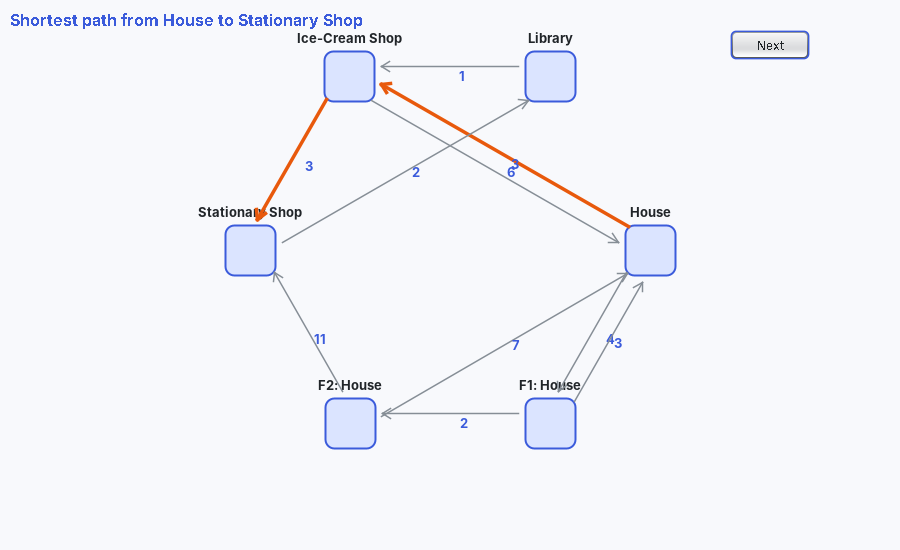
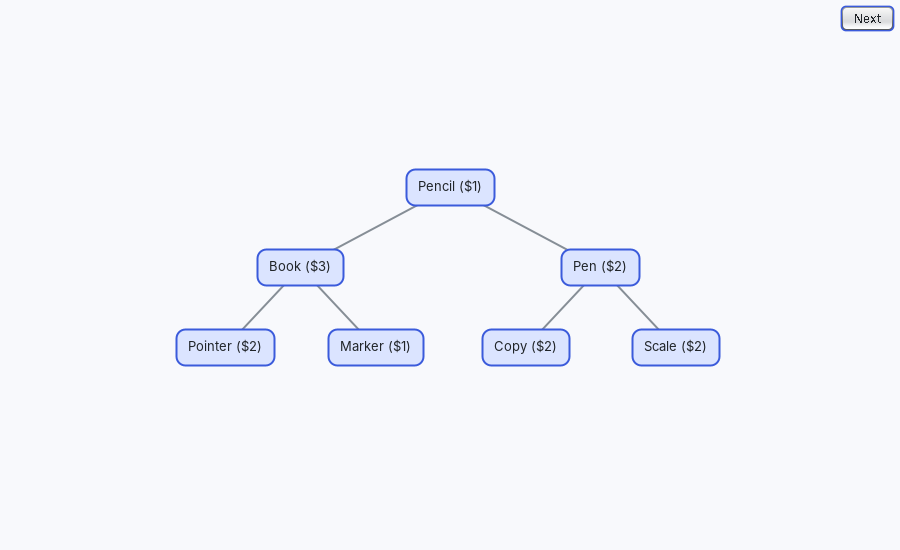
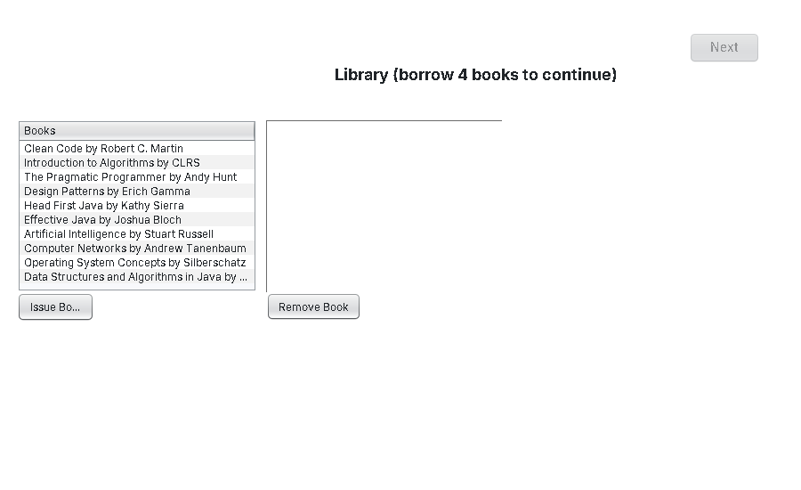

# Java Town Simulator

A Java desktop app that takes you on a trip through a small town. Each place in the town uses a different **data structure**, so you can see where each one is used and why.

I built this project for my **Data Structures** course in the BS Software Engineering programme at the University of Gujrat.

## Screenshots

| Shortest path (graph) | Shop items (binary tree) | Library (queue) |
|---|---|---|
|  |  |  |

## How the trip works

1. **Town map:** the town is drawn as a **graph**. Places (House, Stationary Shop, Ice-Cream Shop, Library) are the nodes, and roads with distances are the edges.
2. **Go to the shop:** the app finds the **shortest path** from House to the Stationary Shop using **Dijkstra's algorithm** with a **priority queue**.
3. **Shop items:** the shop's items are shown as a **binary tree**.
4. **Stationary Shop:** the menu is stored in a **linked list**, and the cart uses a **stack**.
5. **Library:** borrow 4 books to continue. Borrowed books are kept in a **queue** with a fixed size of 4, so the first book borrowed is the first one returned (FIFO). The same book can't be borrowed twice.
6. **Ice Cream Shop:** pick up to 3 flavours and choose quantities. The cart (an **ArrayList**) works out the total price.Both shops check your cart before checkout, so you can't check out with an empty cart.
7. **Back home:** the app finds the shortest path from the Ice-Cream Shop back to the House.

## Data structures used

| Data structure | Where | File |
|---|---|---|
| Graph + Dijkstra's algorithm (priority queue) | Town map and shortest paths | `I_step.java`, `II_step.java`, `IX_step.java`, `X_step.java` |
| Binary tree | Shop items view | `TreeVisualization.java` |
| Linked list | Stationary Shop menu | `Stationary_shop.java` |
| Stack | Stationary Shop cart | `Stationary_shop.java` |
| Queue | Library book loans (max 4) | `Library.java` |
| ArrayList | Ice Cream Shop cart | `iceCream_shop.java` |

## Built with

- Java (Swing for the windows, with Java 2D drawing for the map and tree)
- NetBeans GUI Builder
- A shared colour theme (`Theme.java`), so every screen matches

## How to run

You need **Java 17 or newer**.

```
cd src
javac -d ../out *.java
java -cp ../out Start
```

Or open the project in NetBeans and run it.

## Changelog

I built this app in my 3rd semester. In 2026 I came back to it before publishing it here and made these improvements:

- The road costs used to find the shortest path now match the numbers shown on the map
- Both shops now stop you from checking out with an empty cart
- The Library screen now tells you to borrow 4 books to continue
- A cleaner look: one shared colour theme (`Theme.java`), a redrawn map and tree, and small layout fixes

## Author

**Areesha Khadim**, BS Software Engineering, University of Gujrat
